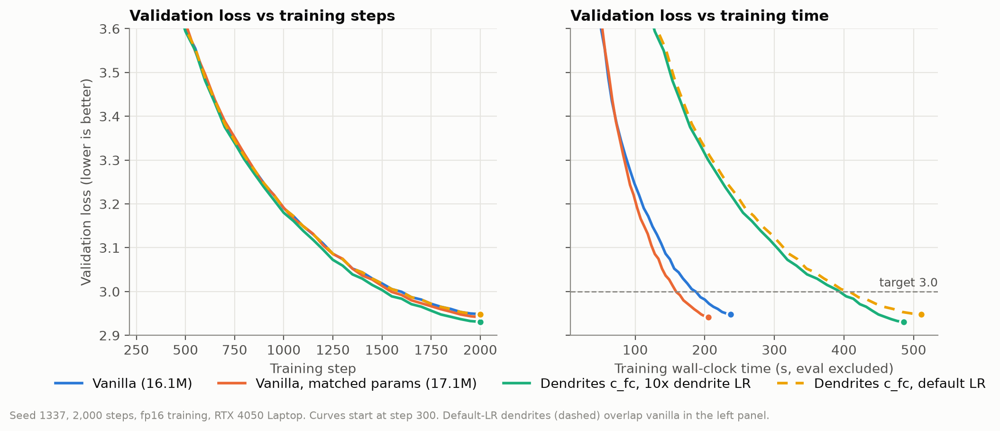
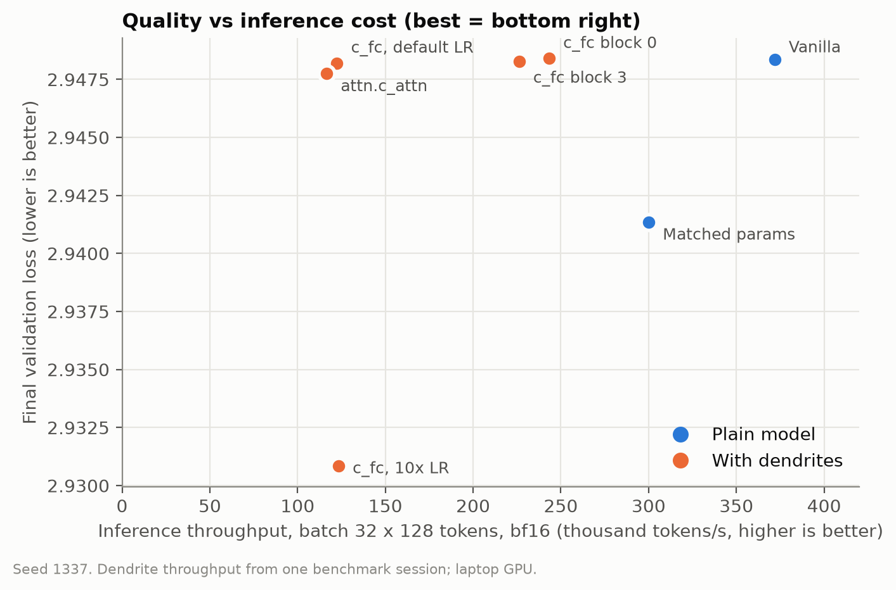
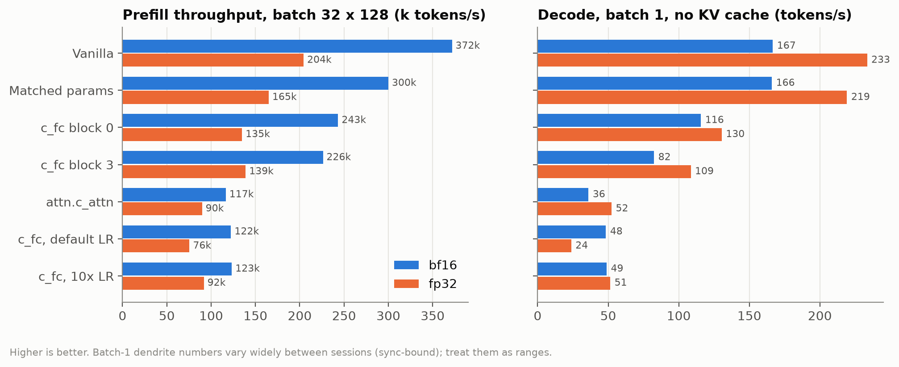
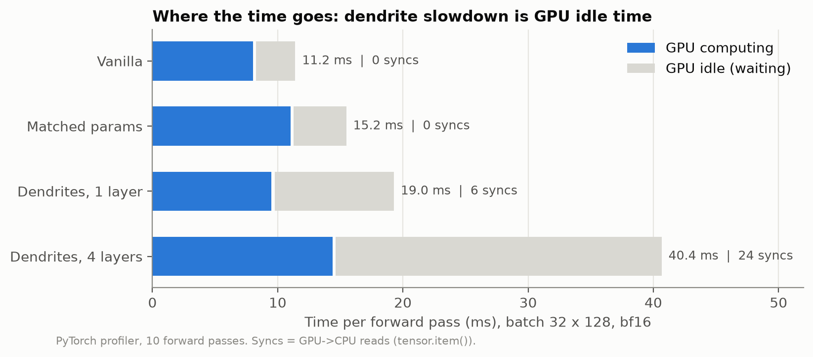

# Perforated Transformers — Midterm Results

**Project:** Perforated Transformers: Training and Inference Efficiency in Decoder-Only Language Models
**Course:** CMU 11-868 LLM Systems
**Team:** Dharun Muthaiah Nataraj, Juan Ortega
**Date:** 2026-11-04

This document records the midterm methodology, code, experiments, results and conclusions. All numbers come from files in `nanogpt/results/` and `nanogpt/out-*/`. The tables can be regenerated with `python make_figures.py`.

---

## 1. Summary

We added PerforatedAI dendrites to a 16M-parameter nanoGPT model trained on TinyStories. We measured quality (validation loss, perplexity) and systems cost (training time, inference throughput, latency, memory, GPU utilization).

1. **With PerforatedAI's default settings, dendrites have no effect on quality.** We tried every placement: MLP input layer in all blocks, attention QKV layer in all blocks, first block only, last block only. Each ended within 0.001 validation loss of vanilla. The dendrites barely learn: their output scales stay near zero.
2. **With a 10× learning rate on dendrite parameters, quality improves slightly.** Mean validation loss over 2 seeds is 2.9293, against 2.9455 for vanilla. A plain model with the **same number of extra parameters** (wider MLP) reaches 2.9365. That accounts for about half of the gain. The remaining edge of dendrites over the matched model is consistent across both seeds (−0.0105 and −0.0038), but it is about the size of seed-to-seed variation, so it is not established.
3. **Dendrites are expensive.** They add 6.6% parameters but make training about 2× slower, inference throughput 2.2–3× lower at batch 32, and batch-1 decode 4–10× slower. The matched-parameter plain model loses only 19% throughput.
4. **The cost comes from the implementation, not from the arithmetic.** The PyTorch profiler shows that each wrapped layer forces **6 GPU→CPU synchronizations per forward pass**. With 4 wrapped layers, the GPU is idle 64% of the time, against 28% for vanilla. Extra GPU computation explains only about 6 ms of the 29 ms slowdown at batch 32. fp32 casting inside dendrites is a minor factor (under 1 ms).

**Conclusion:** in the open-source implementation, dendrites give a small quality gain at roughly the level of simply adding parameters, at a large and mostly avoidable systems cost. Removing the synchronizations could make the dendrite forward pass up to about 2.8× faster. This is an upper bound from the measurements, not tested. Testing it is the natural goal for the final project.

---

## 2. Important deviation: no Perforated Backpropagation

The installed package is the **open-source `perforatedai` 3.2.9**. It does **not** include **Perforated Backpropagation (PB)** (Brenner & Itti, 2025, arXiv 2501.18018), which is distributed separately as `perforatedbp`.

| | What we ran (open-source) | Paper's PB |
|---|---|---|
| Dendrite training | Ordinary gradient descent, jointly with all weights | Correlation (Cascade-Correlation-style) objective: dendrites learn to predict the neuron's error |
| Error through dendrites | Gradients flow through | Not propagated through dendrites |
| Dendrite weights after selection | Keep training | Frozen |
| When dendrites are added | Once, before training (our choice) | When validation plateaus, in cycles |

We verified this by reading the library source and running probe scripts. The dendrite forward pass is:

```
out = Linear(x) + Σ_i to_top_i ⊙ sigmoid(Linear_i(x) + Σ_{j<i} w_ij ⊙ d_j)
```

Each dendrite `Linear_i` is a copy of the wrapped layer, initialized as `randn × 0.01`. `to_top` starts at **zero**, so the model's output is unchanged at the moment dendrites are added.

**Consequences for our claims:**
- The **quality results** describe dendrites trained with standard backpropagation. They are **not** a test of the PB algorithm.
- The **systems results** concern the dendrite forward pass and its tracking code, which PB shares. We expect them to carry over to PB, but we did not measure PB.

Report wording:
> We use the open-source `perforatedai` 3.2.9 release, which trains dendrites by standard backpropagation; it does not include Perforated Backpropagation (Brenner & Itti, 2025), which is distributed separately. Our quality results therefore evaluate dendrite architectures under standard training, not the PB algorithm. Our systems findings concern the shared dendrite forward path and are expected to apply to PB as well, though we did not measure PB directly.

---

## 3. Preliminary investigation (before the midterm runs)

Before running experiments we verified the claims in our project context against the actual code and paper, and built a trustworthy benchmark. This work shaped the methodology.

### 3.1 Verifying PerforatedAI against its source and the PB paper
- **Source:** the installed `perforatedai` 3.2.9 binary matches the public GitHub source line for line. We read the dendrite module, the tracker and the model-wrapping utilities.
- **PB paper** (Brenner & Itti 2025): dendrites are trained with a covariance objective, `Δ_k = (g(in_k) − ḡ)(Δ_i − Δ̄_i)`, the error is not propagated through dendrites, and dendrite input weights are frozen after selection. None of this is in the open-source package (§2).
- **Growth rule in the library:** a dendrite is added after `n_epochs_to_switch = 10` calls to `add_validation_score` without improvement, starting from a reload of the best checkpoint. With the default `testing_dendrite_capacity = True`, the library stops after 3 dendrites (a test mode, not a real experiment).
- **Hidden parameter overhead:** each wrapped layer keeps an unused `parent_module` copy (+262,144 parameters per wrapped `c_fc`, even with zero dendrites). Naive parameter counts are therefore inflated; we count only parameters used in the forward pass.

### 3.2 First latency probe
A probe script wrapped all 4 `mlp.c_fc` layers, forced one dendrite on each, and timed the model. Batch-1 forward latency went from about **5 ms to 23–54 ms**. Code reading and a first profiler pass pointed to about 24 `.item()` calls per forward pass (PAI compares a dimension against a CUDA buffer inside the dendrite forward pass), plus fp32 casting. The midterm profiler (§7.4) confirmed the sync count exactly and showed that casting is minor.

### 3.3 Fixing the inference benchmark
The original pilot script (`inference_benchmark.py`) reported 2.34 ms latency and **257 MiB** peak memory at batch 1, T=64. We found two problems:
- **Inflated memory:** the loaded checkpoint, including the AdamW optimizer state (about 186 MiB), stayed on the GPU. With the checkpoint freed, the real inference peak is about **71 MiB** at that setting.
- **Unstable latency:** the same measurement ranged from 2.3 to 4.1 ms across sessions. The laptop GPU idles at **510 MHz (power state P5)** until it is loaded, so the first timings ran at low clocks.

The new harness (`bench_inference.py`) frees the checkpoint, warms the GPU for 3 s, times with CUDA events, repeats each measurement 5 times, and records the GPU clock, power and temperature. Adding the warm-up cut the batch-32 standard deviation from about 0.4 ms to about 0.1 ms.

### 3.4 Pilot training run
A 1,000-step vanilla run with upstream `train.py` reached val loss 3.2909 (logged to W&B). It validated the data pipeline and the model size, but used a different step budget and evaluation, so it is not part of the comparisons (Appendix A).

### 3.5 Feedback and changes to the proposal
| Item | What we did |
|---|---|
| TA: "add a vanilla baseline with the same parameter count as the PB model, so gains can be attributed to PB rather than extra capacity" | Added the matched-parameter baseline (§4), parameter-for-parameter identical to the `c_fc` dendrite model. Our dendrites are not PB (§2). |
| Proposal assumed Perforated Backpropagation | The available package has no PB; disclosed as a deviation (§2). |
| Hardware | RTX 4050 Laptop GPU; clock variation disclosed and controlled (warm-up, repeated runs, same-session comparisons). |
| Decode | nanoGPT has no KV cache; decode is measured cache-free and labelled as such. |
| New metric | Time and tokens to reach a target validation loss, so quality can be compared per second of training, not only per step. |
| Scope | The ~30M model, larger models, RL/reasoning, LoRA and fine-tuning are future work. |

### 3.6 Experiment-design decisions
- **One dendrite per wrapped layer, added before training.** PAI normally adds dendrites when validation plateaus. Adding them once at the start gives every run the same dendrite count and the same training budget, so runs are directly comparable.
- **Placements:** the planned runs were prioritized as core (vanilla, matched, `c_fc`, `attn.c_attn`), then depth (block 0, block 3). `mlp.c_proj` and `attn.c_proj` were dropped for time.
- **Precision:** fp16 training kept from the pilot; bf16 training not tested.
- **Fixed evaluation batches and data order** (§4), so that loss differences of about 0.001 are not sampling noise.
- **The 10× learning-rate run and the second seed were added** after the first results showed no effect, to test why and to measure run-to-run variation.

### 3.7 Shared repository
The vanilla baseline code (upstream nanoGPT files unmodified, the TinyStories config and data preparation, the pilot benchmark, the PAI smoke test, `requirements.txt` and `.gitignore`) was pushed to `jcortega-projects/perforated-transformers` on branch `feat/vanilla-baseline` (commit `e9dec64`), without datasets, checkpoints or logs. Two known issues were reported but not fixed there: the copied scripts use `from model import` and a relative checkpoint path, and the shared `README.md` is malformed. The midterm code, results and this document are on branch `feat/midterm-experiments`, which builds on `feat/vanilla-baseline`.

---

## 4. Setup

### Hardware and software
| | |
|---|---|
| GPU | NVIDIA GeForce RTX 4050 Laptop, 6 GB (clocks vary between sessions) |
| OS | Windows 11 |
| Python / PyTorch / CUDA | 3.11 / 2.11.0 / 12.8 |
| PerforatedAI | `perforatedai` 3.2.9 (open-source, no `perforatedbp`) |

### Data
TinyStories, tokenized with the GPT-2 BPE tokenizer (`tiktoken`) by `nanogpt/data/tinystories/prepare.py`. The vocabulary is padded to 50,304.

### Model (nanoGPT)
| | |
|---|---|
| Layers / heads / embedding | 4 / 4 / 256 |
| Context length | 128 |
| MLP | `c_fc` 256→1024, GELU, `c_proj` 1024→256 |
| Attention | fused `c_attn` 256→768 (QKV), `c_proj` 256→256 |
| Bias / dropout | none / 0.0 |
| Embeddings | `wte` and `lm_head` tied |
| Parameters used in forward | 16,058,624 |

### Training protocol (identical for every run)
| | |
|---|---|
| Steps | 2,000 |
| Tokens per step | 8 × 4 (grad accumulation) × 128 = 4,096; 8.19M tokens total |
| Optimizer | AdamW, β = (0.9, 0.95), weight decay 0.1 on 2-D tensors (dendrite weights included), grad clip 1.0 |
| Learning rate | 3e-4, linear warm-up 100 steps, cosine decay to 3e-5 at step 2,000 |
| Precision | fp16 autocast with GradScaler, TF32 matmuls, no `torch.compile` |
| Evaluation | every 50 steps on **50 fixed validation batches** (409,600 tokens, generator seed 1234), same tokens for every run and every eval |
| Seeds | 1337 (all runs) and 2024 (vanilla, matched, dendrites at 10× LR) |
| Data order | the training batch stream is re-seeded (`seed + 1`) after model setup, so every run with the same seed sees **identical training batches** |
| Training time | wall-clock time of training steps only, with CUDA synchronization at each eval boundary and eval time excluded |

### How dendrites are added
1. `perforate_model` wraps the chosen modules by exact module ID (for example `.transformer.h.0.mlp.c_fc`) with output dimensions `[-1, -1, 0]` (batch, sequence, channels).
2. One training-mode forward/backward pass on one batch lets PAI record each layer's activation shape.
3. `add_validation_score` is called twice, the second time with `force_switch=True`. This adds **exactly one dendrite to every wrapped module**, before any training.
4. The optimizer and GradScaler are created **after** the restructure. PAI's unused `parent_module` copies are left out of the optimizer and out of parameter counts.
5. Optional `dendrite_lr_mult` multiplies the learning rate of dendrite parameters only (dendrite layer weights and `to_top`).

### Matched-parameter baseline (requested by the TA)
One dendrite on every `mlp.c_fc` adds 4 × (256 × 1024 + 1024) = **1,052,672** used parameters. Widening every MLP hidden layer from 1024 to **1538** adds 4 × 2 × 256 × 514 = **1,052,672**. Both models have exactly **17,111,296** used parameters. The widened layers use nanoGPT's own initialization. `model.py` is unchanged.

### Inference benchmark methodology (`bench_inference.py`)
- The checkpoint is loaded on the CPU, the weights are copied into the model, and the checkpoint is freed before the model moves to the GPU. Peak memory therefore reflects the model, not the optimizer state. The old pilot script reported 257 MiB for this reason; the real figure is about 71–118 MiB.
- A 3-second GPU warm-up runs first, because the laptop GPU idles at 510 MHz. GPU clocks, power and temperature are recorded.
- Timing uses CUDA events. Each setting gets 10 warm-up iterations, then 50 timed iterations, repeated 5 times, giving mean ± std.
- **Prefill:** one forward pass over a prompt, batch ∈ {1, 32} × length ∈ {16, 64, 128}. At batch 1 this equals time-to-first-token (TTFT).
- **Decode:** greedy, **no KV cache** (nanoGPT recomputes the full context at every token), batch 1, 64-token prompt, 32 new tokens. This is **not** KV-cache serving.
- Precision: fp32 and bf16 autocast.

### Profiler methodology (`profile_pai.py`)
The PyTorch profiler (CPU + CUDA) runs over 10 forward passes after a warm-up. Per forward pass it reports:
- wall time, with CUDA synchronization
- GPU busy time (sum of kernel times), giving the GPU idle fraction
- kernel count
- GPU→CPU syncs (`aten::_local_scalar_dense`, i.e. `tensor.item()`, plus `cudaStreamSynchronize`)
- dtype casts (`aten::_to_copy`)

Chrome traces are saved in `nanogpt/results/traces/`.

---

## 5. Code

All files are in `nanogpt/`. Upstream `train.py` and `model.py` are **unmodified**.

| File | Purpose |
|---|---|
| `train_pai.py` | Training script for all midterm runs: vanilla (`perforate=''`), dendrites (`perforate=`, `perforate_blocks=`, `dendrite_lr_mult=`), matched baseline (`mlp_hidden=`). Writes `eval_log.jsonl`, `summary.json` and `ckpt.pt` to `out_dir`. |
| `pai_setup.py` | Shared model construction: `build_gpt` (optionally a wider MLP) and `add_dendrites` (PAI configuration and the one-dendrite restructure). Used by both training and benchmarking, so models are built identically. |
| `config/midterm.py` | Shared settings for every midterm run. |
| `bench_inference.py` | Inference benchmark (prefill/TTFT, cache-free decode, memory, GPU state). Loads vanilla, matched and dendrite checkpoints. Also provides `count_used_params`. |
| `profile_pai.py` | PyTorch-profiler breakdown per forward pass. |
| `make_figures.py` | Builds `results/figures/*.png` and `results/results_tables.md` from the run outputs. |

### Commands (from `nanogpt/`; PowerShell: `$env:PYTHONUTF8 = 1` first)
```
python train_pai.py config/midterm.py --out_dir=out-vanilla-2k
python train_pai.py config/midterm.py --out_dir=out-vanilla-matched --mlp_hidden=1538
python train_pai.py config/midterm.py --out_dir=out-pai-fc        --perforate=mlp.c_fc
python train_pai.py config/midterm.py --out_dir=out-pai-fc-lr10   --perforate=mlp.c_fc --dendrite_lr_mult=10.0
python train_pai.py config/midterm.py --out_dir=out-pai-attn      --perforate=attn.c_attn
python train_pai.py config/midterm.py --out_dir=out-pai-fc-b0     --perforate=mlp.c_fc --perforate_blocks=b0
python train_pai.py config/midterm.py --out_dir=out-pai-fc-b3     --perforate=mlp.c_fc --perforate_blocks=b3
# seed 2: add --seed=2024 and an -s2 suffix to out_dir (vanilla, matched, fc-lr10)

python bench_inference.py --ckpt out-<run>/ckpt.pt --label <run> --amp none
python bench_inference.py --ckpt out-<run>/ckpt.pt --label <run> --amp bfloat16
python profile_pai.py     --ckpt out-<run>/ckpt.pt --label <run> [--trace]
python make_figures.py
```

### Correctness checks performed
| Check | Result |
|---|---|
| Dendrite model equals vanilla at the moment of adding (`to_top` = 0) | Step-0 val loss identical (10.8644 vs 10.8644) |
| Parameter counter ignores PAI's unused copies | +1,052,672 for `c_fc` dendrites = 4 × (256×1024 + 1024), exactly |
| Dendrites are in the forward path | Setting `to_top` = 1 changes logits by up to 1.27 |
| Dendrites are trained | `to_top` moved from 0 to 0.003–0.25; dendrite weights changed |
| Benchmark loader rebuilds trained models correctly | Reloaded checkpoints reproduce the training-time val loss exactly (vanilla 2.9484, matched 2.9414, `c_fc` 10× 2.9308, attn 2.9478) |
| Refactor into `pai_setup.py` changed nothing | Smoke runs reproduce earlier losses exactly (10.4566, 10.4099) |

### PerforatedAI integration issues found (Windows + nanoGPT)
| Problem | Fix |
|---|---|
| `UnicodeEncodeError` (cp1252) in PAI's config save | Run with `PYTHONUTF8=1` (the script checks and exits with a message) |
| Tied `wte`/`lm_head` break safetensors saving | `set_using_safe_tensors(False)` |
| `set_drawing_pai(False)` crashes when a dendrite is added (`KeyError: 'neuron_accuracies'`) | Keep the default; use `MPLBACKEND=Agg` |
| `testing_dendrite_capacity=True` (default) stops after 3 dendrites | `set_testing_dendrite_capacity(False)` |
| Restructure fails with "missing dendrite_storage_shape" | PAI records shapes only during a **training-mode** forward/backward; do one before adding dendrites |
| PAI strips `-` and `\` from `save_name` and writes the folder into the working directory | Use an alphanumeric `save_name`; the `pai*` folders are run artifacts to git-ignore |
| Checkpoint load fails on `tracker_string` size mismatch | It is PAI bookkeeping text (the save-folder name), not a weight; the loader keeps the rebuilt model's value |
| Each wrapped layer keeps an unused `parent_module` copy | Excluded from the optimizer and from parameter counts |
| Upstream `train.py` ignores the `seed` setting in the config (always 1337) | `train_pai.py` honours `seed` |

---

## 6. Experiments

| Run | What changes | Purpose |
|---|---|---|
| `vanilla-2k` | — | Baseline |
| `vanilla-matched` | MLP hidden 1024 → 1538 | Matched-parameter control (TA request) |
| `pai-fc` | Dendrite on `mlp.c_fc`, all 4 blocks | Module type: MLP |
| `pai-attn` | Dendrite on `attn.c_attn`, all 4 blocks | Module type: attention |
| `pai-fc-b0` | Dendrite on `mlp.c_fc`, block 0 only | Depth: early |
| `pai-fc-b3` | Dendrite on `mlp.c_fc`, block 3 only | Depth: late |
| `pai-fc-lr10` | `pai-fc` with 10× learning rate on dendrite parameters | Tests why default dendrites don't learn |
| `*-s2` | seed 2024 for vanilla, matched, `pai-fc-lr10` | Run-to-run variation |

`mlp.c_proj` and `attn.c_proj` placements were deprioritized for time.

---

## 7. Results

### 7.1 Quality

| Model | Params used | Val loss, seed 1337 | Val loss, seed 2024 | Mean | Perplexity (mean) |
|---|---|---|---|---|---|
| Vanilla | 16,058,624 | 2.9484 | 2.9426 | 2.9455 | 19.02 |
| Vanilla, matched params | 17,111,296 | 2.9414 | 2.9316 | 2.9365 | 18.85 |
| Dendrites `c_fc`, default LR | 17,111,296 | 2.9482 | — | 2.9482 | 19.07 |
| **Dendrites `c_fc`, 10× dendrite LR** | 17,111,296 | 2.9308 | 2.9278 | **2.9293** | **18.71** |
| Dendrites `attn.c_attn` | 16,848,128 | 2.9478 | — | 2.9478 | 19.06 |
| Dendrites `c_fc`, block 0 only | 16,321,792 | 2.9484 | — | 2.9484 | 19.08 |
| Dendrites `c_fc`, block 3 only | 16,321,792 | 2.9483 | — | 2.9483 | 19.07 |

**Differences per seed:**

| | Seed 1337 | Seed 2024 |
|---|---|---|
| Matched − vanilla | −0.0070 | −0.0110 |
| Dendrites (10×) − matched | −0.0105 | −0.0038 |
| Dendrites (10×) − vanilla | −0.0175 | −0.0148 |

The same model differs by 0.003–0.010 between the two seeds.

**Placement:** at the default learning rate, every dendrite run stays within 0.001 of vanilla at **every** checkpoint, so there is no measurable difference between MLP and attention or between early and late blocks.

**Why default dendrites don't learn:** the learned `to_top` values (mean |value| per block 0–3):

| | Block 0 | Block 1 | Block 2 | Block 3 |
|---|---|---|---|---|
| Default LR | 0.0034 | 0.0084 | 0.0101 | 0.0091 |
| 10× dendrite LR | 0.052 | 0.160 | 0.233 | 0.245 |

`to_top` starts at zero and multiplies the dendrite output, so at the start the dendrite weights receive **zero** gradient and only `to_top` learns (§8.1 gives our explanation of why it learns slowly). With the default learning rate the dendrites stay nearly switched off for all 2,000 steps. At 10×, they grow 15–25× larger, and later blocks use their dendrites more than early blocks. The 10× gap to vanilla also grows steadily during training: −0.003 at step 200, −0.010 at step 1,000 and −0.0175 at step 2,000.

### 7.2 Training cost (seed 1337)

| Model | Train time (s) | Train tokens/s | Time to val 3.0 (s) | Peak train memory (MiB) |
|---|---|---|---|---|
| Vanilla | 237 | 34.5k | 187 | 924 |
| Vanilla, matched params | 205 | 39.9k | 159 | 948 |
| Dendrites `c_fc`, default LR | 511 | 16.0k | 408 | 965 |
| Dendrites `c_fc`, 10× LR | 486 | 16.9k | 403 | 965 |
| Dendrites `attn.c_attn` | 539 | 15.2k | 426 | 948 |
| Dendrites `c_fc`, block 0 | 388 | 21.1k | 308 | 933 |
| Dendrites `c_fc`, block 3 | 391 | 21.0k | 314 | 933 |

Seed-2024 training times: vanilla 199 s, matched 206 s, dendrites 10× 408 s. Training time on this laptop varies by about ±15% between runs; the matched model trained faster than vanilla in seed 1337 for that reason. The ~2× dendrite slowdown is far outside that noise.

- Wrapping **one** layer already costs about 64% more training time (block 0: +150 s, block 3: +154 s).
- Wrapping **four** layers costs about 115–127% more (`c_fc`: +274 s; `attn.c_attn`: +302 s).
- In **training**, the first wrapped layer costs much more than each additional one (about +64% for the first, about +17% for each of the next three). In **inference** the cost grows roughly linearly with the number of wrapped layers (§7.4, §8.2). Training was not profiled, so the reason for the large first-layer training cost is not established.

### 7.3 Inference cost

| Model | Prefill B32×T128 bf16 (tok/s) | Prefill B32×T128 fp32 (tok/s) | Decode B1 bf16 (tok/s) | Decode B1 fp32 (tok/s) | TTFT B1×T64 fp32 (ms) | Peak memory (MiB) |
|---|---|---|---|---|---|---|
| Vanilla | 371,804 | 204,360 | 166.7 | 233.5 | 4.4 ± 0.1 | 118 |
| Vanilla, matched params | 300,028 (−19%) | 165,014 (−19%) | 166.0 | 219.2 | 5.1 ± 0.3 | 138 |
| Dendrites `c_fc`, default LR | 122,413 (−67%) | 75,586 (−63%) | 48.4 | 23.8 | 115.4 ± 5.2 | 167 |
| Dendrites `c_fc`, 10× LR | 123,339 (−67%) | 91,817 (−55%) | 48.9 | 51.5 | 35.3 ± 24.1 | 167 |
| Dendrites `attn.c_attn` | 116,556 (−69%) | 89,797 (−56%) | 36.0 | 52.4 | 80.2 ± 3.7 | 145 |
| Dendrites `c_fc`, block 0 | 243,314 (−35%) | 134,902 (−34%) | 115.7 | 130.4 | 23.7 ± 5.3 | 161 |
| Dendrites `c_fc`, block 3 | 226,212 (−39%) | 138,966 (−32%) | 82.5 | 108.5 | 10.8 ± 0.7 | 161 |

Peak memory is the maximum over the prefill grid (largest at B32×T128). Dendrite-model memory includes PAI's unused `parent_module` copies, but these are small (4 × 262,144 fp32 values ≈ 4 MiB for 4 wrapped `c_fc` layers). Most of the extra memory is likely the dendrite path's intermediate activations; we did not break memory down further.

**Notes:**
- **Batch-1 numbers for dendrite models are unreliable as single values.** `pai-fc` and `pai-fc-lr10` have identical structure, yet one measured 115 ms TTFT and the other 35 ms. At batch 1 the GPU mostly waits on the CPU (§7.4), so CPU scheduling noise dominates. Report them as ranges. Vanilla is stable to ±0.3 ms.
- **bf16 slows vanilla decode at batch 1** (167 vs 233 tok/s). At batch 1 the work is so small that the extra cast kernels cost more than bf16 saves. At batch 32, bf16 nearly doubles vanilla throughput.
- **bf16 helps dendrite models much less** than vanilla, which widens the gap at batch 32. The profiler explains why: bf16 shrinks GPU compute time, but the sync idle time stays the same (§8.3).

### 7.4 Profiler: where the time goes

Per forward pass:

| Model | Shape, precision | Wall (ms) | GPU busy (ms) | GPU idle | Kernels | GPU→CPU syncs | dtype casts (GPU ms) |
|---|---|---|---|---|---|---|---|
| Vanilla | B32×T128 bf16 | 11.2 | 8.0 | 28% | 78 | 0 | 27 (0.69) |
| Vanilla, matched | B32×T128 bf16 | 15.2 | 11.0 | 28% | 74 | 0 | 27 (0.72) |
| Dendrites, 1 layer (`c_fc` b3) | B32×T128 bf16 | 19.0 | 9.5 | 50% | 97 | **6** | 30 (0.91) |
| Dendrites, 4 layers (`c_fc`) | B32×T128 bf16 | 40.4 | 14.4 | **64%** | 154 | **24** | 39 (1.57) |
| Vanilla | B32×T128 fp32 | 22.8 | 19.4 | 15% | 56 | 0 | 1 |
| Dendrites, 4 layers | B32×T128 fp32 | 54.7 | 27.4 | 50% | 120 | 24 | 1 |
| Vanilla | B1×T64 fp32 | 4.8 | 1.0 | 78% | 56 | 0 | 1 |
| Dendrites, 4 layers | B1×T64 fp32 | 21.1 | 1.4 | 93% | 124 | 24 | 1 |

**Findings:**
1. **Exactly 6 GPU→CPU syncs per wrapped layer per forward pass** (6 with 1 layer, 24 with 4). Vanilla has none. Each sync stops the CPU from queuing more GPU work until the GPU catches up. By code reading, the syncs come from PAI's Python-side checks on CUDA tensors (for example comparing a dimension against a CUDA buffer) inside the dendrite forward pass.
2. **The slowdown is mostly idle time.** At B32 bf16 the dendrite model is 29.2 ms slower than vanilla. Only 6.4 ms of that is extra GPU computation; about 23 ms is the GPU waiting.
3. **dtype casts are not the bottleneck.** They add 0.9 ms (39 vs 27 cast ops), under 1 ms of the 29 ms.
4. **The matched plain model adds the same parameters for +3 ms of GPU time and no idle time.** Dendrites spend more GPU time for the same parameter count (+6.4 ms), likely because the dendrite path runs as several extra kernels (a second matmul, sigmoid, multiply, add: 154 vs 78 kernels) instead of one wider matmul. We did not break GPU time down per kernel.
5. **Upper bound on a fix:** if all syncs were removed, the dendrite model could at best run at its GPU-busy time. That is 14.4 ms instead of 40.4 ms, up to about 2.8× faster, still about 1.3× slower than vanilla. This bound was not tested.
6. **At batch 1 everything is launch-bound:** vanilla is already 78% idle, and dendrite models reach 93%. This explains the noisy batch-1 latency.

### 7.5 Figures
| Figure | Content |
|---|---|
|  | **Fig. 1** Validation loss vs training steps (left) and vs training time (right). Per step, dendrites at 10× LR end lowest; per second of training, plain models are far ahead. |
|  | **Fig. 2** Final validation loss vs inference throughput (B32×T128 bf16). Best is bottom right. |
|  | **Fig. 3** Prefill throughput and cache-free decode speed, bf16 and fp32. |
|  | **Fig. 4** Forward-pass time split into GPU computing and GPU idle. |

---

## 8. Interpretation: what the results mean

This section separates what we **measured** from what we **infer**. Hypotheses are labelled as such.

### 8.1 Why default dendrites don't learn, and what the 10× run tells us
- **Measured:** with `to_top = 0`, a dendrite's output is multiplied by zero, so at the start its weights get exactly zero gradient and only `to_top` can move. After 2,000 steps at the default learning rate, `to_top` is 0.003–0.01; at 10× it is 0.05–0.25, and the loss gain grows steadily during training.
- **Hypothesis:** the dendrite weights start at `randn × 0.01`, so each dendrite's pre-activation is close to zero and its sigmoid output is close to a constant 0.5. Early on, a dendrite therefore acts like a small learned per-channel offset, which gives `to_top` a weak, noisy gradient. Adam takes steps of about the learning rate only when gradients are consistent, so `to_top` grows slowly, and until it grows the dendrite weights receive almost no gradient. This slow start would explain why only a higher learning rate helped. We did not log gradients, so this is not verified.
- **Measured:** later blocks learn larger dendrite scales (block 3: 0.245, block 0: 0.052 at 10×). Our depth runs (block 0 vs block 3) used the default learning rate, where neither learned, so **depth effects remain an open question**.

### 8.2 Where the inference cost comes from
- **Measured:** every wrapped layer adds exactly 6 GPU→CPU syncs per forward pass. The extra GPU idle time divided by the number of syncs is consistent across all settings:

| Setting | Extra idle vs vanilla, 1 layer (6 syncs) | Per sync | Extra idle, 4 layers (24 syncs) | Per sync |
|---|---|---|---|---|
| B32×T128 bf16 | +6.4 ms | 1.06 ms | +22.9 ms | 0.95 ms |
| B32×T128 fp32 | +5.3 ms | 0.88 ms | +23.9 ms | 1.00 ms |
| B1×T64 bf16 | +6.9 ms | 1.15 ms | +16.6 ms | 0.69 ms |
| B1×T64 fp32 | +5.1 ms | 0.85 ms | +16.0 ms | 0.67 ms |

- **Inference:** each sync costs roughly **0.7–1.2 ms of idle GPU time**, and inference overhead grows about linearly with the number of wrapped layers. A sync makes the CPU wait until the GPU has finished all queued work. The CPU then has to run PAI's Python code and launch the next kernels while the GPU sits idle, so the GPU can never run ahead of the CPU.
- **The matched-parameter model** shows what the same extra parameters cost without PAI: +3.0 ms of GPU compute at B32 bf16 and essentially no extra idle time.

### 8.3 Why bf16 widens the gap
- **Measured:** bf16 cuts vanilla's GPU compute at B32×T128 from 19.4 ms to 8.0 ms. The 4-layer dendrite model's idle time barely changes (27.3 ms fp32, 26.0 ms bf16).
- **Inference:** faster arithmetic does not shorten sync stalls, so the faster the GPU computes, the larger the share of time spent waiting (idle 50% in fp32, 64% in bf16). Our earlier hypothesis that fp32 casting inside dendrites was the reason is **not supported**: the extra casts cost 0.9 ms.
- At batch 1, bf16 even slows vanilla (167 vs 233 tok/s decode): the 26 extra cast kernels cost more than bf16 saves when each matmul is tiny.

### 8.4 Why batch-1 numbers are noisy
At batch 1 the GPU is idle 78% of the time even for vanilla; the forward pass is limited by how fast the CPU launches kernels. With dendrites the GPU is idle 93% of the time, so latency depends almost entirely on CPU speed and scheduling, which vary on a laptop. That explains standard deviations of up to ±50 ms, non-monotonic latency across prompt lengths (Appendix B), and the 115 vs 35 ms TTFT for two structurally identical models. Batch-32 throughput is the reliable cost measure.

### 8.5 Training cost
- **Measured:** training time grows by +64% for one wrapped layer and +115–127% for four, and training throughput drops from 34.5k to 15–21k tokens/s. Peak training memory grows only modestly (+9 to +41 MiB).
- **Not explained:** unlike inference, training cost is not linear in the number of wrapped layers. Backward passes, the optimizer step and PAI's per-module tracking could each contribute; training was not profiled.

### 8.6 Quality per step vs quality per second
- **Per training step,** the 10× dendrite model is best (val loss 2.929 vs 2.937 matched vs 2.946 vanilla, 2-seed means).
- **Per second of training,** the plain models win clearly: vanilla reaches val loss 3.0 in 155–187 s and the matched model in 159–160 s; the best dendrite model needs 283–403 s.
- **Per unit of inference throughput,** the matched model buys about half of the dendrites' quality gain for a 19% throughput cost; dendrites cost 55–69%.
- For a systems evaluation, time and throughput are the relevant budgets, so under the current implementation **a wider plain model is the better use of the same parameters**.

### 8.7 What we can and cannot claim

| Claim | Supported? |
|---|---|
| Open-source PAI dendrites at the default LR do not change quality in this setup | Yes (all 4 placements, within 0.001) |
| Dendrites at 10× LR beat vanilla at equal steps | Yes (both seeds, by 0.015–0.018, larger than seed variation) |
| Dendrites beat a matched-parameter model at equal steps | Not established (same sign in both seeds, size within seed variation) |
| Dendrites are 2–3× more expensive in training time and batch-32 throughput | Yes (well outside the ±15% timing noise) |
| The overhead is mostly GPU idle time from GPU→CPU syncs | Yes (profiler) |
| fp32 casting is the main overhead | No (under 1 ms) |
| Removing syncs would give up to about 2.8× speedup | Upper bound from measurements; not tested |
| Placement (MLP vs attention, early vs late) does not matter | Not supported; only tested where dendrites barely learn |
| Results apply to Perforated Backpropagation | Quality: no. Systems: probably (shared forward path), not measured |

---

## 9. Conclusions

1. **Quality:** under standard backpropagation and 2,000 steps, dendrites help only when their parameters get a much higher learning rate (10×). Even then the gain over vanilla (−0.016 mean) is about half explained by extra capacity. The remaining edge over a matched-parameter model (−0.007 mean) is consistent in sign but within seed noise.
2. **Default settings fail for this transformer:** with PerforatedAI's default learning rate, dendrites added at initialization stay almost switched off (`to_top` starts at zero and grows only to about 0.003–0.01). Placement (MLP vs attention, early vs late) makes no difference **in that regime**. Because the dendrites barely learned there, this does **not** show that placement is irrelevant. The 10× run suggests later blocks use dendrites more (§8.1), so the placement comparison should be repeated at 10×.
3. **Cost:** dendrites roughly double training time and cut batch-32 inference throughput 2.2–3×, for 6.6% more parameters. Per unit of training time or inference throughput, a slightly wider plain model is clearly better.
4. **Cause:** the cost is dominated by host-device synchronization (6 syncs per wrapped layer, each costing about 0.7–1.2 ms of GPU idle time), not by FLOPs or dtype casts. It is an implementation overhead, so it is fixable.
5. **Answer to "do dendrites improve efficiency?"** In the open-source implementation, no. They are a quality-per-step technique with a large wall-clock penalty. Whether an efficient dendrite implementation, or the PB algorithm, changes this is open.

---

## 10. Limitations

- **No Perforated Backpropagation.** Quality results are for standard-backprop dendrites only (§2).
- **Short training:** 2,000 steps (8.2M tokens) on a 16M model; the models are far from converged.
- **Seeds:** two seeds for the three key models, one for the placement runs.
- **Dendrites added once at initialization,** not cyclically on validation plateaus as in PAI's intended workflow.
- **Learning-rate tuning was unequal:** dendrites got a 10× learning-rate test; vanilla and the matched baseline were not tuned.
- **Laptop GPU:** clocks, power and temperature vary between sessions, giving about ±15% variation in training time and noisy batch-1 latency. Batch-32 throughput and profiler counts are the most reliable cost numbers.
- **Cache-free decode:** nanoGPT's `generate()` has no KV cache, so decode numbers are not representative of production serving.
- **Small evaluation:** validation loss and perplexity only, no downstream tasks.
- **Placements not tested:** `mlp.c_proj` and `attn.c_proj`. The placement comparison was only run at the default learning rate, where dendrites barely learn.
- **Training not profiled:** the profiler covers inference forward passes only; training-time overhead is measured but not broken down.

---

## 11. Future work (final project)

1. **Remove the syncs:** rewrite the dendrite forward pass so it never reads GPU values on the CPU, then measure how much of the up-to-2.8× bound is recovered.
2. **Fuse the dendrite with its layer:** compute main layer and dendrite in one matmul with a fused sigmoid/scale, so dendrites cost about as much as the matched-width model.
3. **Re-evaluate quality vs cost** once dendrites are cheap: do they beat the matched model at equal wall-clock time?
4. **Perforated Backpropagation:** request `perforatedbp` access through Perforated AI (Rorry) and compare PB dendrites with standard-backprop dendrites on the same harness.
5. **Better dendrite training:** learning-rate sweep, non-zero `to_top` initialization, dendrites added at plateaus, longer runs, more seeds, and the placement comparison (MLP vs attention, early vs late) repeated at the 10× learning rate.
6. **Scale and serving:** the planned ~30M model, KV-cache decoding verified token-by-token against `generate()`, and larger-batch serving benchmarks.

---

## 12. File locations

| What | Where |
|---|---|
| Per-run eval curves | `nanogpt/out-<run>/eval_log.jsonl` locally; `nanogpt/results/runs/<run>/` in the repo |
| Per-run summaries | `nanogpt/out-<run>/summary.json` locally; `nanogpt/results/runs/<run>/` in the repo |
| Checkpoints (not for git) | `nanogpt/out-<run>/ckpt.pt` |
| Training logs | `nanogpt/results/logs/train_<run>.log` |
| Inference benchmarks | `nanogpt/results/bench_<run>_<none|bfloat16>.json` |
| Profiler summaries | `nanogpt/results/profile_<run>.json` |
| Chrome traces | `nanogpt/results/traces/` (open in ui.perfetto.dev); not committed (20 MB), regenerate with `profile_pai.py --trace` |
| Figures | `nanogpt/results/figures/` |
| Tables | `nanogpt/results/results_tables.md` |
| PAI internal saves (not for git) | `nanogpt/paiout*/` |
| Project context and TA review | `perforated_ai_context.md` (local working notes, not in the repo) |

---

## Appendix A. Pilot run (1,000 steps, before the midterm protocol)

Trained with upstream `train.py` and `config/train_tinystories.py` (same model, 1,000 steps, lr decay to 1,000, eval on 20 random batches, seed 1337 because `train.py` ignores the config's `seed = 42`). Final checkpoint: iter 1000, val loss 3.2909. It is not used in the comparisons, because its step budget and eval protocol differ.

Benchmark of the pilot checkpoint (an earlier session, `results/bench_vanilla_*.json`):

| Precision | TTFT B1×T64 (ms) | Prefill B32×T128 (tok/s) | Decode B1 (tok/s) | Peak memory (MiB) | SM clock after warm-up |
|---|---|---|---|---|---|
| fp32 | 2.52 ± 0.37 | 193,525 | 410.2 | 118 | 1380 MHz |
| bf16 | 4.32 ± 0.66 | 402,234 | 253.4 | 106 | 1455 MHz |

The same architecture measured 4.4 ms TTFT in the later session (§7.3) instead of about 2.5 ms here. This is the session-to-session variation of the laptop GPU; compare models only within one benchmark session. Decode speed differs even more (410 vs 233 tok/s fp32), because batch-1 decode is launch-bound and sensitive to CPU clock state.

## Appendix B. Full prefill grid (latency ms, mean ± std over 5 runs of 50 iterations)

**fp32**

| Model | B1×T16 | B1×T64 | B1×T128 | B32×T16 | B32×T64 | B32×T128 |
|---|---|---|---|---|---|---|
| vanilla-2k | 5.37 ± 0.91 | 4.44 ± 0.15 | 5.90 ± 1.14 | 6.28 ± 1.85 | 12.06 ± 0.61 | 20.04 ± 0.15 |
| vanilla-matched | 4.81 ± 0.67 | 5.15 ± 0.31 | 4.72 ± 0.53 | 7.22 ± 0.42 | 14.39 ± 0.16 | 24.82 ± 0.32 |
| pai-fc | 73.78 ± 41.09 | 115.41 ± 5.23 | 114.07 ± 5.25 | 119.86 ± 2.77 | 75.04 ± 8.89 | 54.19 ± 3.05 |
| pai-fc-lr10 | 28.40 ± 12.96 | 35.29 ± 24.12 | 79.97 ± 0.58 | 84.49 ± 31.51 | 32.35 ± 1.10 | 44.61 ± 1.95 |
| pai-attn | 29.02 ± 22.01 | 80.20 ± 3.68 | 110.29 ± 5.44 | 121.30 ± 3.05 | 67.08 ± 1.33 | 45.61 ± 2.15 |
| pai-fc-b0 | 17.35 ± 6.09 | 23.68 ± 5.26 | 21.86 ± 1.94 | 31.07 ± 1.57 | 16.97 ± 1.70 | 30.36 ± 0.52 |
| pai-fc-b3 | 10.23 ± 1.65 | 10.76 ± 0.66 | 10.69 ± 0.32 | 12.21 ± 0.97 | 17.56 ± 0.49 | 29.47 ± 0.95 |

**bf16**

| Model | B1×T16 | B1×T64 | B1×T128 | B32×T16 | B32×T64 | B32×T128 |
|---|---|---|---|---|---|---|
| vanilla-2k | 7.08 ± 0.75 | 5.80 ± 0.25 | 6.09 ± 1.04 | 6.30 ± 0.80 | 7.94 ± 0.25 | 11.02 ± 0.28 |
| vanilla-matched | 5.24 ± 0.50 | 6.96 ± 0.37 | 5.23 ± 0.08 | 5.88 ± 0.23 | 9.22 ± 0.74 | 13.65 ± 0.27 |
| pai-fc | 82.85 ± 46.73 | 49.02 ± 50.50 | 31.65 ± 19.63 | 30.28 ± 8.05 | 27.91 ± 1.10 | 33.46 ± 1.16 |
| pai-fc-lr10 | 36.65 ± 30.51 | 79.13 ± 34.75 | 40.44 ± 2.21 | 42.52 ± 0.69 | 24.84 ± 3.85 | 33.21 ± 1.20 |
| pai-attn | 85.06 ± 47.62 | 130.89 ± 6.26 | 130.64 ± 6.16 | 125.25 ± 7.41 | 61.78 ± 1.88 | 35.14 ± 0.95 |
| pai-fc-b0 | 15.32 ± 1.44 | 11.92 ± 0.62 | 12.32 ± 0.68 | 11.63 ± 1.01 | 13.58 ± 1.43 | 16.83 ± 0.43 |
| pai-fc-b3 | 15.53 ± 2.06 | 13.65 ± 1.39 | 13.69 ± 1.20 | 12.63 ± 1.18 | 14.16 ± 2.05 | 18.11 ± 0.93 |

**Reading this grid:** vanilla and the matched model scale as expected with batch and length. Dendrite-model cells are dominated by sync stalls and are not monotonic: for example `pai-fc` measured 119.9 ms at B32×T16 but 54.2 ms at B32×T128, which is 8× more tokens. Standard deviations reach ±41 ms. Only B32×T128 (the largest, most compute-bound setting) is used for dendrite comparisons in the main text.

## Appendix C. Cache-free decode detail (batch 1, 64-token prompt, 32 new tokens)

| Model | Precision | Per-token latency (ms) | First token (ms) | Tokens/s | Peak memory (MiB) |
|---|---|---|---|---|---|
| vanilla-2k | fp32 | 4.28 ± 0.59 | 3.77 | 233.5 | 72 |
| vanilla-2k | bf16 | 6.00 ± 1.31 | 7.17 | 166.7 | 95 |
| vanilla-matched | fp32 | 4.56 ± 0.23 | 4.23 | 219.2 | 76 |
| vanilla-matched | bf16 | 6.03 ± 0.92 | 9.08 | 166.0 | 99 |
| pai-fc | fp32 | 41.99 ± 17.43 | 36.62 | 23.8 | 89 |
| pai-fc | bf16 | 20.68 ± 0.90 | 18.33 | 48.4 | 111 |
| pai-fc-lr10 | fp32 | 19.44 ± 1.19 | 21.75 | 51.5 | 89 |
| pai-fc-lr10 | bf16 | 20.46 ± 1.46 | 22.18 | 48.9 | 111 |
| pai-attn | fp32 | 19.10 ± 4.21 | 19.54 | 52.4 | 86 |
| pai-attn | bf16 | 27.75 ± 4.27 | 26.20 | 36.0 | 109 |
| pai-fc-b0 | fp32 | 7.67 ± 1.34 | 8.84 | 130.4 | 83 |
| pai-fc-b0 | bf16 | 8.64 ± 0.78 | 8.71 | 115.7 | 105 |
| pai-fc-b3 | fp32 | 9.22 ± 0.51 | 9.24 | 108.5 | 83 |
| pai-fc-b3 | bf16 | 12.13 ± 2.36 | 11.72 | 82.5 | 105 |

## Appendix D. Full profiler results (per forward pass)

| Model | Precision | Shape | Wall (ms) | GPU busy (ms) | GPU idle | Kernels | `.item()` syncs | Stream syncs | dtype casts (GPU ms) |
|---|---|---|---|---|---|---|---|---|---|
| vanilla-2k | fp32 | B1×T64 | 4.75 | 1.03 | 78% | 56 | 0 | 1 | 1 (0.00) |
| vanilla-2k | fp32 | B32×T128 | 22.75 | 19.40 | 15% | 56 | 0 | 1 | 1 (0.00) |
| vanilla-2k | bf16 | B1×T64 | 7.87 | 1.65 | 79% | 74 | 0 | 1 | 27 (0.77) |
| vanilla-2k | bf16 | B32×T128 | 11.15 | 8.01 | 28% | 78 | 0 | 1 | 27 (0.69) |
| vanilla-matched | fp32 | B1×T64 | 5.72 | 1.21 | 79% | 56 | 0 | 1 | 1 (0.00) |
| vanilla-matched | fp32 | B32×T128 | 27.19 | 24.03 | 12% | 56 | 0 | 1 | 1 (0.00) |
| vanilla-matched | bf16 | B1×T64 | 7.04 | 1.73 | 75% | 78 | 0 | 1 | 27 (0.77) |
| vanilla-matched | bf16 | B32×T128 | 15.23 | 11.02 | 28% | 74 | 0 | 1 | 27 (0.72) |
| pai-fc-b3 | fp32 | B1×T64 | 10.08 | 1.26 | 87% | 73 | 6 | 7 | 1 (0.00) |
| pai-fc-b3 | fp32 | B32×T128 | 29.75 | 21.14 | 29% | 72 | 6 | 7 | 1 (0.00) |
| pai-fc-b3 | bf16 | B1×T64 | 15.12 | 1.99 | 87% | 93 | 6 | 7 | 30 (0.72) |
| pai-fc-b3 | bf16 | B32×T128 | 19.03 | 9.51 | 50% | 97 | 6 | 7 | 30 (0.91) |
| pai-fc-lr10 | fp32 | B1×T64 | 21.13 | 1.43 | 93% | 124 | 24 | 25 | 1 (0.00) |
| pai-fc-lr10 | fp32 | B32×T128 | 54.73 | 27.43 | 50% | 120 | 24 | 25 | 1 (0.00) |
| pai-fc-lr10 | bf16 | B1×T64 | 24.73 | 1.87 | 92% | 150 | 24 | 25 | 39 (0.72) |
| pai-fc-lr10 | bf16 | B32×T128 | 40.41 | 14.39 | 64% | 154 | 24 | 25 | 39 (1.57) |

Top operators by CPU time for each setting are in `results/profile_<run>.json` (`top_ops_by_self_cpu`).

## Appendix E. All training runs

| Run | Seed | Params used | Final val loss | Best val loss | Train time (s) | Train tokens/s | Time to val 3.0 (s) | Step reaching 3.0 | Peak train memory (MiB) |
|---|---|---|---|---|---|---|---|---|---|
| vanilla-2k | 1337 | 16,058,624 | 2.9484 | 2.9484 | 237 | 34,527 | 187 | 1600 | 924 |
| vanilla-matched | 1337 | 17,111,296 | 2.9414 | 2.9414 | 205 | 39,946 | 159 | 1550 | 948 |
| pai-fc | 1337 | 17,111,296 | 2.9482 | 2.9482 | 511 | 16,034 | 408 | 1600 | 965 |
| pai-fc-lr10 | 1337 | 17,111,296 | 2.9308 | 2.9308 | 486 | 16,867 | 403 | 1550 | 965 |
| pai-attn | 1337 | 16,848,128 | 2.9478 | 2.9478 | 539 | 15,201 | 426 | 1600 | 948 |
| pai-fc-b0 | 1337 | 16,321,792 | 2.9484 | 2.9484 | 388 | 21,140 | 308 | 1600 | 933 |
| pai-fc-b3 | 1337 | 16,321,792 | 2.9483 | 2.9483 | 391 | 20,963 | 314 | 1600 | 933 |
| vanilla-2k-s2 | 2024 | 16,058,624 | 2.9426 | 2.9426 | 199 | 41,119 | 155 | 1550 | 924 |
| vanilla-matched-s2 | 2024 | 17,111,296 | 2.9316 | 2.9316 | 206 | 39,857 | 160 | 1550 | 948 |
| pai-fc-lr10-s2 | 2024 | 17,111,296 | 2.9278 | 2.9278 | 408 | 20,096 | 283 | 1500 | 965 |

Full per-eval curves (every 50 steps: train loss, val loss, tokens, training time, learning rate, peak memory) are in `out-<run>/eval_log.jsonl`.
